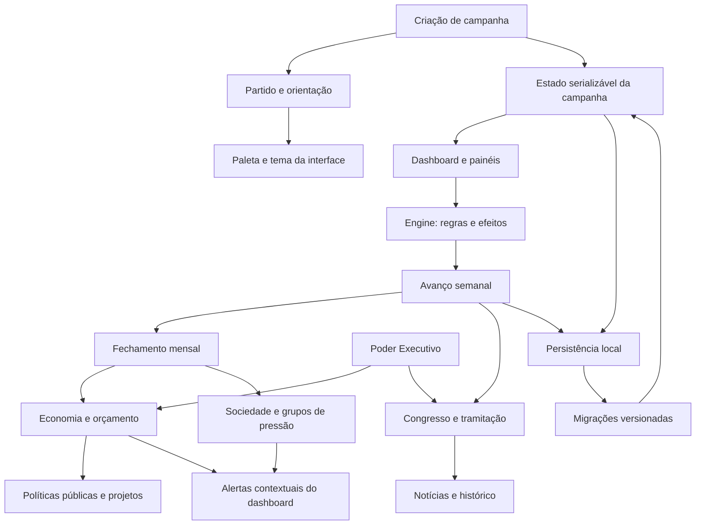
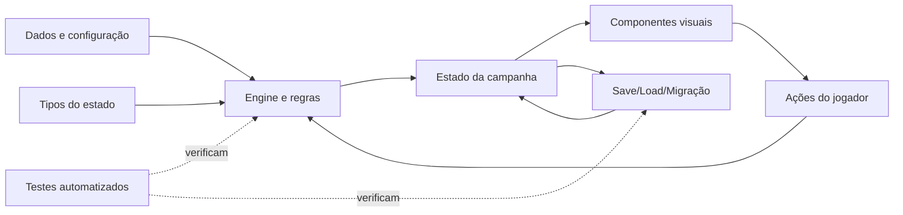

# Mapa mental — Palácio em Jogo

Atualizado em: 2026-10-16  
Branch de referência: `codex/phase-3a-congress`  
Versão atual do save: `v8`

Este arquivo é o mapa geral do projeto para pessoas e IAs que forem continuar o desenvolvimento. Antes de alterar qualquer sistema, leia também `AGENTS.md`, `docs/STATUS.md`, `docs/PROXIMOS_PASSOS.md` e as seções relevantes do Documento Mestre.

## 1. Visão de alto nível

A aplicação é React + TypeScript + Vite. Não há servidor/backend, banco de dados ou API externa de IA; a campanha e o histórico ficam no navegador em LocalStorage. O jogo exporta/importa backups JSON. Essa escolha permite um protótipo simples de navegador, mas significa que campanhas não sincronizam automaticamente entre dispositivos.

## 2. Loop principal de jogo

1. Criar campanha, escolher orientação política e uma legenda satírica ou criar um partido personalizado.
2. O tema visual usa as duas cores do partido; o motor deriva variantes para contraste.
3. Ver os indicadores do país, caixa, capital político, capacidade administrativa, apoio político, notícias e alertas.
4. Navegar pelos painéis e executar ações com recursos e custos.
5. Escolher uma decisão/evento da semana, quando apresentado.
6. Avançar semana: aplicar efeitos pendentes, progresso dos projetos, eventos narrativos e tramitação legislativa.
7. No fechamento mensal: executar orçamento e ministérios, calcular mudanças sociais/econômicas, fechar o histórico e apresentar balanço.
8. Salvar automaticamente e permitir continuar/exportar a campanha.

Calendário atual: início em janeiro de 2027, quatro semanas por mês. Dinheiro, pontos de ação, capital político e capacidade administrativa são recursos separados.

## 3. Subsistemas e dependências

| Subsistema | Código principal | Depende de / afeta | Estado |
|---|---|---|---|
| Campanha, partido e tema | `src/engine/campaign.ts`, `src/engine/theme.ts`, `src/data/parties.ts`, `src/data/campaignConfig.ts` | Estado inicial, cores, recursos e narração de abertura | Implementado |
| Interface central e navegação | `src/App.tsx`, `src/components/TopNavigation.tsx`, `src/components/Dashboard.tsx` | Todos os painéis funcionais | Implementado, com placeholders conhecidos |
| Turnos e eventos | `src/engine/turn.ts`, `src/data/*Events.ts`, `src/data/actions.ts` | Calendário, efeitos pendentes, decisões e histórico | Primeira versão |
| Executivo/ministérios | `src/engine/executive.ts`, `src/components/ExecutivePanel.tsx` | Orçamento, desempenho administrativo, apoio político e propostas legislativas | Primeira versão |
| Economia e finanças | `src/engine/economy.ts`, `src/components/EconomyPanel.tsx`, `src/data/economy.ts` | Caixa, receitas/despesas, dívida, tributos, dotações e projetos | Primeira versão; valores internos em R$ bilhões |
| Políticas públicas | `src/engine/projects.ts`, `src/data/publicPrograms.ts`, `src/components/PolicyProjectsPanel.tsx` | Dotação setorial, caixa, capacidade administrativa, indicadores e eventos | Primeira versão |
| Sociedade | `src/engine/society.ts`, `src/data/society.ts`, `src/components/SocietyPanel.tsx` | Cinco classes, sete grupos organizados, pressão, diálogo, compromissos e acontecimentos mensais | Primeira versão |
| Congresso | `src/engine/legislature.ts`, `src/data/legislature.ts`, `src/components/LegislaturePanel.tsx` | PL/PLP/PEC/MP/PPA/LDO/LOA, votações, sanção/veto e efeitos orçamentários | Fase 3.1 implementada; rito simplificado |
| Relações internacionais/defesa | Componentes e dados a completar | Diplomacia, comércio, defesa e indicadores externos | Incompleto |
| Judiciário | Próximo subsistema planejado | Processos, decisões e recursos independentes do Executivo | Pendente — Fase 3.2 |
| Órgãos de controle/crises | Próximo subsistema planejado | Investigações, fiscalização e crises institucionais | Pendente — Fase 3.3 |
| Personagens e relações | Documento Mestre, seção 15 | Lealdade, ambição, alianças, promessas, memória e autonomia | Parcial/pendente — Fase 4 |
| Imprensa | Documento Mestre, seção 16 | Rumores, evidências e crises de imagem | Pendente — Fase 4 |
| Eleições e continuidade | Documento Mestre, seção 17 | Pesquisas, campanha eleitoral, cadeiras, segundo turno e sucessão | Pendente — Fase 5 |
| Conteúdo/balanceamento | Catálogos em `docs/` e diretório `src/data/` | Personagens, narrativas e campanhas longas | Pendente — Fase 6 |

## 4. Recursos e números: regras que não podem se misturar

- **Dinheiro/caixa:** montantes financeiros; unidade numérica interna = R$ bilhões. Formatação visual usa real, milhões, bilhões e trilhões. Caixa disponível não é igual a orçamento anual.
- **Orçamento anual:** autorização/planejamento distribuído por setores e ministérios; uma dotação não deve ser usada além do seu saldo ainda não executado.
- **Receita/despesa/dívida:** efeitos financeiros de um período afetam caixa, saldo e risco; não se deve criar dinheiro só porque uma lei foi aprovada.
- **Pontos de ação:** limitam decisões importantes por semana. Navegação e consulta de informação devem ser gratuitas.
- **Capital político:** representa capacidade de articulação/influência e não pode substituir dinheiro.
- **Capacidade administrativa:** limita implementação, execução e entrega de programas; não é saldo monetário.
- **Aprovação presidencial, apoio no Congresso, popularidade partidária, Maré Ideológica e força eleitoral:** conceitos separados. Uma melhoria de um indicador não deve atualizar os outros automaticamente sem uma regra explícita.

## 5. Identidade visual partidária

- A fonte única dos pares de cores é `src/data/campaignConfig.ts`; os partidos satíricos usam pares inspirados nas identidades reais, com códigos oficiais quando publicados e aproximações explicitamente documentadas quando não.
- O PTP usa vermelho e branco como referência ao PT; o PSÓ usa vermelho e amarelo como referência ao PSOL; PDTT usa vermelho e azul como referência ao PDT; PLIM usa azul e verde como referência ao PL; PSSDB usa azul e amarelo como referência ao PSDB; NOVA usa laranja e azul-marinho como referência ao NOVO.
- A primeira cor é o destaque principal; a segunda compõe elementos de apoio, ícones, bordas e grafismos. O tema calcula variantes de contraste para a interface escura.
- A fonte de referência e distinção entre cores oficiais e aproximações está em `docs/CORES_DOS_PARTIDOS.md`.
- Partidos personalizados preservam as duas cores escolhidas pelo jogador.

## 6. Persistência e migração

- Versão atual do save: v8.
- v7 → v8: atualiza tema/paleta de partidos predefinidos nas campanhas existentes; mantém as cores de partido personalizado.
- v6 → v8: migra o estado legislativo e atualiza a paleta; não reescala os valores financeiros já convertidos para reais.
- v5 e versões mais antigas: passam pela regra histórica de conversão monetária para a escala em R$ bilhões, além de inicializações/migrações dos sistemas posteriores.
- LocalStorage é local ao navegador. Backup JSON é a forma atual de transportar a campanha.
- Sempre que alterar o shape do estado persistido, aumente `CURRENT_SAVE_VERSION`, adicione migração determinística e testes específicos para v atual, versões imediatamente anteriores e versões legadas relevantes.

## 7. Arquitetura e fluxo de mudança

- `src/state/types.ts`: tipos/shape serializável.
- `src/data/`: parâmetros e conteúdo; quóruns e números de cadeiras não devem ser fixados dentro de componentes.
- `src/engine/`: regras; lógica política não deve morar na UI.
- `src/components/`: renderização, formulários e callbacks para ações do engine.
- `src/persistence/`: armazenamento, validação, import/export e migração.
- `docs/STATUS.md`: resumo técnico atual.
- `docs/PROXIMOS_PASSOS.md`: roadmap para outra IA.
- `docs/CORES_DOS_PARTIDOS.md`: pesquisa visual partidária.
- `docs/AVALIACAO_PRONTIDAO.md`: prontidão real do produto e lacunas.
- `docs/RELATORIO_FASE_3_1_CLAUDE.md`: handoff detalhado da Fase 3.1.
- `docs/RELATORIO_CORES_E_PRONTIDAO.md`: histórico desta mudança de cores, resultado de validação e visão geral de prontidão.
- Este arquivo: mapa sistêmico de alto nível.

## 8. Mapa do estado atual e próximos passos

1. **Fundação/Fase 1:** campanha, navegação principal, calendário, decisões, recursos e saves locais.
2. **Fase 2:** primeira versão do Executivo, economia, políticas públicas e sociedade; não é uma simulação macroeconômica completa.
3. **Fase 3.1:** Congresso com tramitação e votação aproximadas; precisa de auditoria jurídica/regimental e testes manuais de interface.
4. **Fase 3.2:** Judiciário independente.
5. **Fase 3.3:** órgãos de controle e crises institucionais.
6. **Fase 4:** personagens, autonomia/memória, imprensa e interesses sistêmicos.
7. **Fase 5:** Maré Ideológica, pesquisas, eleições e continuidade.
8. **Fase 6:** catálogo amplo de personagens/eventos, balanceamento de campanhas longas e revisão visual/institucional.

## 9. Regra de documentação contínua

A cada alteração relevante no código, atualizar pelo menos:
- `docs/STATUS.md`: estado atual, validação do HEAD atual, limites e bugs conhecidos.
- `docs/PROXIMOS_PASSOS.md`: tarefas encerradas e próximo trabalho em ordem.
- `docs/MAPA_MENTAL.md`: somente quando a arquitetura, os estados ou as dependências sistêmicas mudarem; conservar como visão geral.
- O relatório temático correspondente (por exemplo, cores, migração, fase legislativa ou avaliação de prontidão) quando a alteração mexer diretamente nesse assunto.

O relatório deve registrar: o que mudou, por que mudou, arquivos principais, resultado real de testes/build, falhas encontradas e corrigidas e próximos passos. Não afirmar testes manuais que não ocorreram. Não declarar “jogo pronto” com base apenas em teste/build.

## 10. Observação sobre “pronto”

O jogo é uma base jogável em desenvolvimento, ainda não um produto final. O detalhe dos sistemas implementados, pendentes, limitações e critérios mínimos de lançamento está em `docs/AVALIACAO_PRONTIDAO.md`. Esta classificação só deve mudar depois de completar sistemas essenciais do escopo, testar campanhas longas e realizar uma revisão real de usabilidade em desktop/celular.
